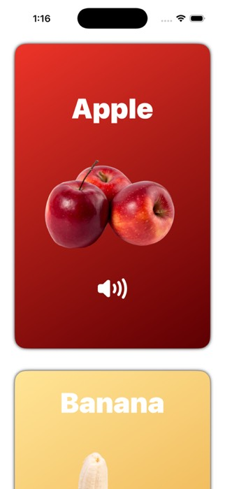
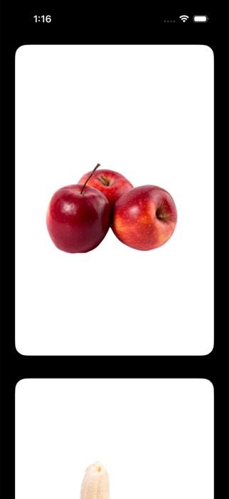

# Project Analysis — ABC School

Phase 1 audit (read-only). Baseline: commit `05d8060`, Xcode 26.3 (iOS 26.2 SDK), audited 2026-11-25.

## 1. What the product is

The README promises: *"Improving your child English pronunciation is possible even offline. Learn English
pronunciation by listening to how words are pronounced and repeating them."*

- **Audience:** young children (about 3–7) learning English, often as a second language. A parent or
  teacher sets the device up and usually sits next to the child.
- **What they need:** to hear a word said correctly, say it back, and find out whether they got it right.
  It has to work anywhere, without internet.
- **What exists today:** only the "listen" part, and only for 11 fruits.

## 2. Inventory

| Area | Contents | Notes |
|---|---|---|
| Source | 5 Swift files, about 186 lines | `FruitsApp`, `ContentView`, `FruitsView`, `Fruits` (model and data), `PlaySound` |
| Images | 12 transparent fruit PNGs, 500–665 px | Good quality, consistent style. The guava image is never used. |
| Colors | 24 gradient color sets | Every dark-mode variant is pure white |
| Audio | 4 MP3 recordings (apple, Banana, Orange, Strawberry), 0.6–1.2 s | 7 of the 11 cards reuse `apple.mp3` |
| Project | 1 app target, iOS 16.2, Swift 5 | No tests, no shared scheme, `xcuserdata` committed, no `.gitignore` |
| Dependencies | None | Good; keep it that way |

## 3. How it works today

There is one screen: a vertical `ScrollView` of fixed-size (350 × 545 pt) gradient cards. Each card shows a
title, an image that scales in on appear, and a speaker button that calls a global `playsound()` function.

| Light mode | Dark mode |
|---|---|
|  |  |

## 4. Findings

### Critical: the product is broken

1. **Wrong pronunciation.** Pineapple, Peach, Grape, Fig, Watermelon, Kiwi and Pomegranate all play
   `apple.mp3`, so the app teaches the wrong word for 7 of its 11 cards.
2. **Dark Mode is blank.** Every color set's dark variant is white. That turns every card white, and the white
   title disappears into it.
3. **The silent switch mutes the app.** No audio session is configured, so the default `soloAmbient`
   category silences all playback when the ring/silent switch is on. On many phones the app looks broken.
4. **The layout doesn't fit every screen.** The fixed 350 pt card plus 16 pt padding overflows the 375 pt
   iPhone SE width. On iPad it wastes most of the screen, and on iPhone landscape is enabled but the layout
   doesn't adapt.
5. **There is no app icon**, so the app can't be submitted.

### Missing pieces of the README promise

- "Repeating them": there is no way to record yourself, hear yourself, or get feedback.
- There is no progress and no reinforcement. There are only 11 words, and no alphabet despite the name "ABC School".
- The app's display name is "Fruits".

### Code and architecture

- The model type `Fruits` (plural for a single item) imports SwiftUI and stores `Color`. Its `massage` field
  is unused and wrong (it says "Apple" for Banana), and its `UUID()` ids change on every launch.
- Content is hard-coded in a global array, and typos show up in the UI ("Pinapple", lowercase "peach",
  "grape", "fig"…). Pineapple uses `Pinapple02` for both gradient stops.
- `FruitsView` has an unused `gradient` property and commented-out code.
- `PlaySound.swift` keeps a global mutable `audioPlayer` (not concurrency-safe) and reports errors with
  `print` using the wrong message. It also does nothing, silently, when a file is missing.
- Resource names mix cases (`Banana.mp3` vs `apple.mp3`). The device file system is case-sensitive, so a
  mismatched name works in the Simulator but fails on a real iPhone.
- Previews still use the old `PreviewProvider`. There are no tests, and the toolchain settings date from 2023.

### Accessibility

- The speaker button has no spoken label, and the images have none either.
- The fixed 50 pt title ignores Dynamic Type.
- White-on-yellow titles (Banana, Orange, Pineapple, Peach) fail contrast, and the hard black shadow looks
  dated.

### Worth keeping

- The transparent fruit photos.
- The 4 human recordings.
- The light fruit gradient palette.
- No third-party dependencies, and the SwiftUI app lifecycle.

## 5. Baseline build

`xcodebuild build` succeeds on Xcode 26.3 (iPhone 17 Pro, iOS 26.3 Simulator) with no warnings in app code.
The app launches and plays the four recordings correctly.
